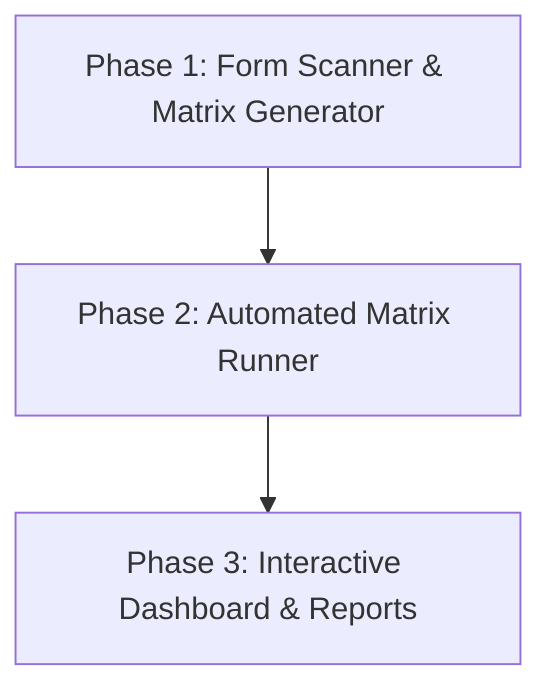

# 🧪 Codeless QA Test Generator & Runner Journey

Welcome to the advanced phase of your AI development journey! We are building an enterprise-grade **Codeless QA Test Generator and Runner**.

---

## 🗺️ The Project Plan

### 🟢 Phase 1: Form Scanner & Matrix Generator
* **The Goal:** Build a script that goes to a webpage, extracts all fields (labels, inputs, required attributes), and asks Gemini to generate a complete JSON Test Matrix containing positive, boundary, and negative test cases.
- [x] **Task 1.1:** Learn Python's JSON processing and nested structures.
- [x] **Task 1.2:** Write a crawler script to extract form fields and structure.
- [x] **Task 1.3:** Call Gemini to generate a JSON array of specific test scenarios.

### 🟡 Phase 2: Automated Matrix Runner
* **The Goal:** Build the executor engine. It reads the JSON test matrix, opens a browser, runs each test scenario automatically (types, clicks), captures validation errors, and logs results (PASS/FAIL).
- [ ] **Task 2.1:** Learn list looping and dynamic Playwright inputs.
- [ ] **Task 2.2:** Build the batch execution loop for tests.
- [ ] **Task 2.3:** Save execution logs and screenshots for each test run.

### 🟠 Phase 3: Interactive Dashboard & Reports
* **The Goal:** Build a beautiful web app dashboard where developers can input a URL, watch the progress of the test suite execution in real-time, view pass/fail counts, and open screenshots of failed assertions.
- [ ] **Task 3.1:** Connect FastAPI endpoints to the batch runner.
- [ ] **Task 3.2:** Build a premium dashboard UI showing report statistics and screenshot carousels.
