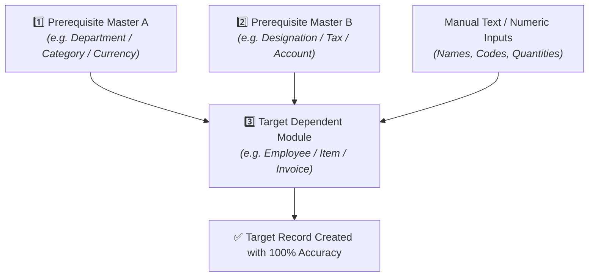

# 🌐 Universal Master-Dependency & State Testing Framework (For All Projects)

This framework provides a **universal, domain-agnostic architecture** to test dependent modules and relational master data across **ANY software project** (ERP, HRMS, Healthcare, Finance, Supply Chain, Inventory, E-commerce, etc.) with 100% accuracy.

---
 
## 🏗️ Universal 3-Layer Dependency Architecture



---

## 🌍 Examples Across Diverse Project Domains

| Industry / Domain | Prerequisite Masters (Recorded First) | Target Dependent Module | Chain Prerequisites Config |
|---|---|---|---|
| **Human Resources (HRMS)** | `department_master`, `designation_master` | `employee_master` | `login, department_master, designation_master` |
| **Inventory & ERP** | `category_master`, `unit_master`, `tax_master` | `item_master` | `login, category_master, unit_master, tax_master` |
| **Finance & Accounting** | `currency_master`, `chart_of_accounts` | `invoice_entry` | `login, currency_master, chart_of_accounts` |
| **Healthcare / Clinic** | `doctor_master`, `specialty_master` | `patient_appointment` | `login, doctor_master, specialty_master` |
| **Manufacturing** | `raw_material_master`, `vendor_master` | `purchase_order` | `login, raw_material_master, vendor_master` |

---

## 🚫 Universal Active / Inactive Cascade Exclusion Rule

Across **ALL projects and modules**, the system enforces 2 universal state rules:

1. **Active Rule**: Items created with `Status = Active` **MUST** be present in dynamic target dropdowns.
2. **Inactive Exclusion Rule**: Items marked `Status = Inactive` (or Soft-Deleted) **MUST be excluded** (`count = 0`) from dynamic target dropdowns.

```mermaid
graph TD
    ACT["🟢 Active Master Item<br/><i>(Status = Active)</i>"] -->|✅ Included| DROP1["Target Module Dropdown"]
    INACT["🔴 Inactive Master Item<br/><i>(Status = Inactive)</i>"] -->|❌ Excluded (count = 0)| DROP2["Target Module Dropdown"]
```

---

## 🛠️ Step-by-Step Implementation Workflow for Any New Project

### Step 1: Record Master Flows First
In Tab 1 (**Flow Recorder**), record simple creation actions for each prerequisite master module in your project.

### Step 2: Configure Prerequisites in Dashboard
In Tab 2 (**AI Execution Platform**), select your target dependent flow and set:
```text
Chain Prerequisites / Dependencies: login, master_a, master_b
```

### Step 3: Run AI Generation & Execution
- Click **🤖 Multi-Agent Generate** to generate all CRUD, boundary, security, and state-exclusion test cases.
- Click **Start Execution**. The runner automatically seeds master data, resolves dependencies, and executes target scenarios with 100% precision.
