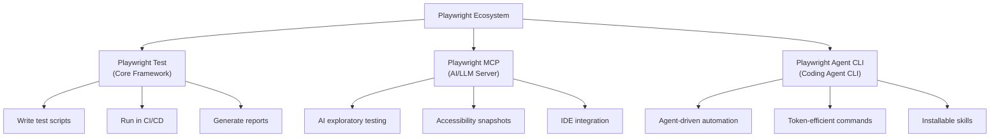
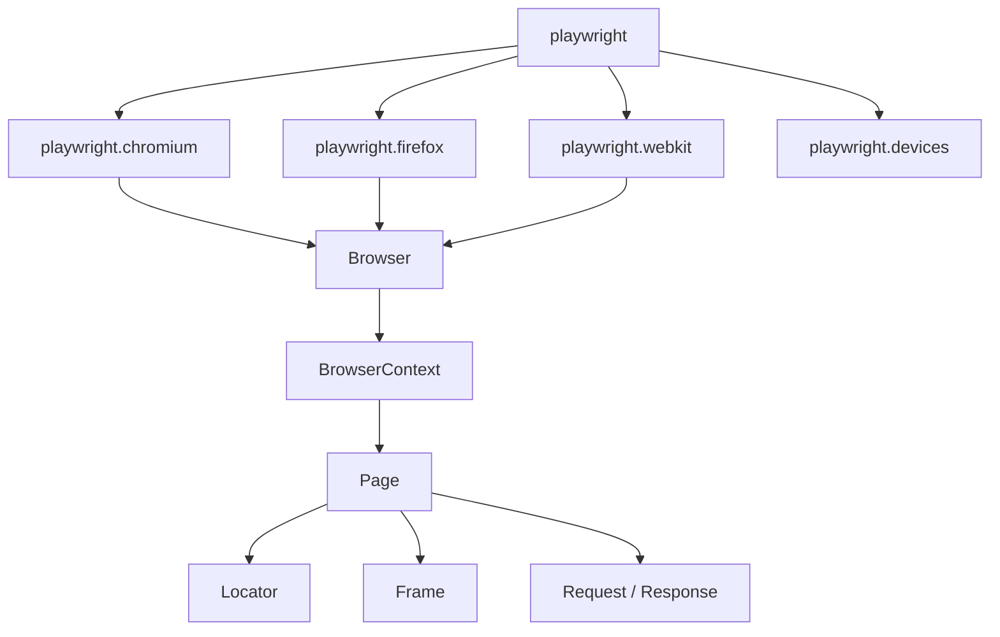
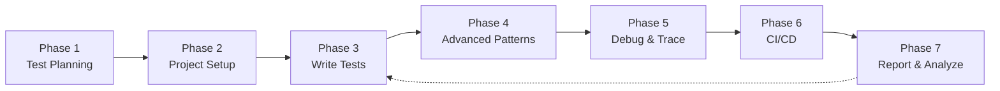

# Playwright QA Automation Testing — Complete Guide for Quality Assurance Engineers

**Document Version:** 1.0  
**Date:** 22 July 2026  
**Author:** QA Research & Analysis  
**Sources Verified:** playwright.dev/docs/intro, playwright.dev/mcp/introduction, playwright.dev/agent-cli/introduction, playwright.dev/docs/api/class-playwright

---

## Table of Contents

1. [Executive Summary](#1-executive-summary)
2. [Source Link Verification Report](#2-source-link-verification-report)
3. [What is Playwright?](#3-what-is-playwright)
4. [Playwright Ecosystem Overview](#4-playwright-ecosystem-overview)
5. [Environment Setup & Installation](#5-environment-setup--installation)
6. [Playwright Core API — Key Classes for QA](#6-playwright-core-api--key-classes-for-qa)
7. [QA Automation Testing Workflow — End-to-End](#7-qa-automation-testing-workflow--end-to-end)
8. [Phase 1 — Test Planning & Strategy](#phase-1--test-planning--strategy)
9. [Phase 2 — Project Setup & Configuration](#phase-2--project-setup--configuration)
10. [Phase 3 — Writing Test Cases](#phase-3--writing-test-cases)
11. [Phase 4 — Advanced Testing Patterns](#phase-4--advanced-testing-patterns)
12. [Phase 5 — Debugging & Tracing](#phase-5--debugging--tracing)
13. [Phase 6 — CI/CD Integration](#phase-6--cicd-integration)
14. [Phase 7 — Reporting & Analysis](#phase-7--reporting--analysis)
15. [Playwright MCP — AI-Assisted Testing](#8-playwright-mcp--ai-assisted-testing)
16. [Playwright Agent CLI — Agent-Driven Automation](#9-playwright-agent-cli--agent-driven-automation)
17. [MCP vs Agent CLI — Decision Matrix for QA](#10-mcp-vs-agent-cli--decision-matrix-for-qa)
18. [Complete QA Automation Checklist](#11-complete-qa-automation-checklist)
19. [Glossary](#12-glossary)

---

## 1. Executive Summary

This document provides a **complete, step-by-step guide** for QA engineers to implement automation testing using the Playwright framework. It covers the full Playwright ecosystem — the core testing library, the MCP (Model Context Protocol) server for AI-assisted testing, the Agent CLI for coding-agent-driven automation, and the API reference for advanced programmatic control.

> [!IMPORTANT]
> This guide is based on live research of the official Playwright documentation as of July 2026. All four source URLs were verified as accessible and serving current content.

**Core Message:** A QA engineer can build a production-grade automation testing framework using Playwright by following a structured 7-phase workflow — from test planning through CI/CD integration — and can accelerate their work using the newer MCP and Agent CLI tools for AI-assisted test authoring and debugging.

---

## 2. Source Link Verification Report

| # | URL | Status | Page Title | Content Summary |
|---|-----|--------|------------|-----------------|
| 1 | https://playwright.dev/docs/intro | ✅ **Active** | Installation \| Playwright | Core installation guide, setup instructions, first test walkthrough |
| 2 | https://playwright.dev/mcp/introduction | ✅ **Active** | Introduction \| Playwright | MCP server for AI/LLM-driven browser automation via accessibility snapshots |
| 3 | https://playwright.dev/agent-cli/introduction | ✅ **Active** | Introduction \| Playwright | CLI for coding agents — token-efficient commands and installable skills |
| 4 | https://playwright.dev/docs/api/class-playwright | ✅ **Active** | Playwright Library \| Playwright | API reference for the Playwright class — browser launch, device emulation |

> [!NOTE]
> All four links returned HTTP 200 and served valid Docusaurus-rendered documentation pages (Docusaurus v3.10.1). Each page includes proper canonical URLs, OpenGraph metadata, and structured data (BreadcrumbList schema). The documentation supports Node.js, Python, Java, and .NET language variants.

---

## 3. What is Playwright?

Playwright is an **open-source, end-to-end testing framework** developed by Microsoft that enables reliable automation of web applications across all modern browsers.

### Key Capabilities

| Capability | Description |
|-----------|-------------|
| **Cross-browser** | Chromium, Firefox, WebKit — all from a single API |
| **Cross-platform** | Windows, macOS, Linux |
| **Cross-language** | Node.js (TypeScript/JavaScript), Python, Java, .NET |
| **Auto-wait** | Automatically waits for elements to be actionable before performing actions |
| **Web-first assertions** | Assertions that automatically retry until the condition is met |
| **Tracing** | Post-mortem debugging with trace viewer, screenshots, and video recording |
| **Parallelism** | Full test isolation via browser contexts; runs tests in parallel by default |
| **Code generation** | Record user interactions and auto-generate test code (`codegen`) |

### Why QA Engineers Should Use Playwright

1. **No flaky tests** — Auto-wait eliminates the #1 cause of test instability.
2. **Fast execution** — Browser contexts are lightweight; no full browser restart per test.
3. **Full isolation** — Each test gets its own browser context (cookies, storage, cache isolated).
4. **Built-in tooling** — Trace viewer, test generator, HTML reporter require zero extra setup.
5. **Modern web support** — Shadow DOM, iframes, Web Components, multi-tab scenarios.

---

## 4. Playwright Ecosystem Overview

Playwright now offers **three complementary interfaces** for browser automation. A QA engineer should understand all three to choose the right tool for each task.



| Interface | Best For | How It Works | Default Mode |
|-----------|----------|-------------|--------------|
| **Playwright Test** | Structured test suites, CI/CD, regression testing | QA writes test scripts in code | Headless |
| **Playwright MCP** | AI-assisted exploratory testing, IDE copilots | LLM calls MCP tools with structured parameters | Headed |
| **Playwright Agent CLI** | Coding agents automating browser tasks alongside code | Agent runs shell commands | Headless |

---

## 5. Environment Setup & Installation

### Prerequisites

| Requirement | Details |
|------------|---------|
| **Node.js** | Version 18 or higher |
| **OS** | Windows 10+, macOS 13 Ventura+, or Debian 11 / Ubuntu 20.04+ |
| **Disk Space** | ~500 MB for browser binaries |

### Step 1 — Install Playwright Test Framework

```bash
# Initialize a new Playwright project (interactive wizard)
npm init playwright@latest

# Or install into an existing project
npm install -D @playwright/test

# Install browser binaries
npx playwright install
```

**What gets created:**
```
project-root/
├── playwright.config.ts     # Configuration file
├── package.json             # Updated with @playwright/test dependency
├── package-lock.json
├── tests/
│   └── example.spec.ts      # Example test file
├── tests-examples/
│   └── demo-todo-app.spec.ts # Full demo test suite
└── .github/
    └── workflows/
        └── playwright.yml   # GitHub Actions workflow (optional)
```

### Step 2 — Install Playwright MCP Server (Optional — for AI-assisted testing)

The Playwright MCP server enables LLMs (in VS Code, Cursor, Windsurf, etc.) to interact with web pages through structured accessibility snapshots.

```jsonc
// VS Code settings.json — add MCP server configuration
{
  "mcp": {
    "servers": {
      "playwright": {
        "command": "npx",
        "args": ["@playwright/mcp@latest"]
      }
    }
  }
}
```

**Configuration for other editors:**

```jsonc
// Cursor — .cursor/mcp.json
{
  "mcpServers": {
    "playwright": {
      "command": "npx",
      "args": ["@playwright/mcp@latest"]
    }
  }
}
```

```jsonc
// Windsurf — ~/.codeium/windsurf/mcp_config.json
{
  "mcpServers": {
    "playwright": {
      "command": "npx",
      "args": ["@playwright/mcp@latest"]
    }
  }
}
```

### Step 3 — Install Playwright Agent CLI (Optional — for coding agents)

```bash
# Global installation
npm install -g @playwright/cli@latest

# Or run via npx
npx playwright-cli --help

# Install browser binaries
playwright-cli install-browser

# Install skills (reference guides for coding agents)
playwright-cli install --skills
```

---

## 6. Playwright Core API — Key Classes for QA

Based on the [API reference](https://playwright.dev/docs/api/class-playwright), the Playwright module provides the following hierarchy that every QA engineer must understand:



### Key Classes and Their QA Use

| Class | Purpose | QA Use Case |
|-------|---------|-------------|
| **Playwright** | Entry point — launches browser instances | Choose browser engine for cross-browser testing |
| **Browser** | A browser instance (Chromium, Firefox, or WebKit) | Manage browser lifecycle |
| **BrowserContext** | An isolated browser session (cookies, storage) | Test isolation — each test gets a fresh context |
| **Page** | A single tab/window | Navigate, interact, assert |
| **Locator** | A way to find elements on the page | Click, fill, assert on elements |
| **Frame** | An iframe inside a page | Test embedded content |
| **Request / Response** | Network activity | API testing, mock responses, intercept requests |

### Typical API Usage Pattern

```javascript
const { chromium } = require('playwright');

(async () => {
  // Launch browser
  const browser = await chromium.launch();
  
  // Create isolated context
  const context = await browser.newContext();
  
  // Create page
  const page = await context.newPage();
  
  // Navigate
  await page.goto('https://example.com');
  
  // Interact
  await page.locator('#username').fill('testuser');
  await page.locator('#password').fill('password123');
  await page.locator('button[type="submit"]').click();
  
  // Assert
  await expect(page.locator('.welcome-message')).toBeVisible();
  
  // Cleanup
  await browser.close();
})();
```

### Browser Launch Options (from API Reference)

```javascript
// Headed mode (visible browser) — useful for debugging
const browser = await chromium.launch({ headless: false });

// Slow motion — slows down each action for visual debugging
const browser = await chromium.launch({ slowMo: 500 });

// Device emulation — test mobile viewports
const iPhone = playwright.devices['iPhone 14'];
const context = await browser.newContext({ ...iPhone });
```

---

## 7. QA Automation Testing Workflow — End-to-End

This is the complete 7-phase workflow a QA engineer should follow when implementing Playwright automation for any application.



---

## Phase 1 — Test Planning & Strategy

Before writing a single test, the QA engineer must plan.

### 1.1 — Identify Test Scope

| Test Type | What to Cover | Playwright Suitability |
|-----------|--------------|----------------------|
| **Smoke Tests** | Critical paths (login, checkout, core CRUD) | ✅ Excellent |
| **Regression Tests** | All previously-broken functionality | ✅ Excellent |
| **E2E Functional Tests** | Full user workflows across pages | ✅ Excellent |
| **Cross-Browser Tests** | Same tests on Chromium, Firefox, WebKit | ✅ Built-in |
| **Visual Regression** | Screenshot comparison | ✅ Built-in (`toHaveScreenshot`) |
| **API Tests** | Backend endpoint validation | ✅ Supported (`request` context) |
| **Accessibility Tests** | WCAG compliance checks | ✅ Supported (snapshot-based) |
| **Performance Tests** | Load times, Core Web Vitals | ⚠️ Basic (use Lighthouse integration) |
| **Unit Tests** | Individual function logic | ❌ Use Jest/Vitest instead |

### 1.2 — Define Test Matrix

```
Browsers:       Chromium, Firefox, WebKit
Viewports:      Desktop (1280×720), Tablet (768×1024), Mobile (375×667)
OS:             Windows, macOS, Linux (via CI)
Auth States:    Logged out, Regular user, Admin user
Environments:   Dev, Staging, Production
```

### 1.3 — Naming Convention

Adopt a consistent naming convention for test files:

```
tests/
├── auth/
│   ├── login.spec.ts
│   ├── logout.spec.ts
│   └── password-reset.spec.ts
├── dashboard/
│   ├── dashboard-load.spec.ts
│   └── dashboard-widgets.spec.ts
├── orders/
│   ├── create-order.spec.ts
│   ├── cancel-order.spec.ts
│   └── order-history.spec.ts
└── api/
    ├── user-api.spec.ts
    └── order-api.spec.ts
```

---

## Phase 2 — Project Setup & Configuration

### 2.1 — playwright.config.ts — Production-Grade Configuration

```typescript
import { defineConfig, devices } from '@playwright/test';

export default defineConfig({
  // Directory containing test files
  testDir: './tests',
  
  // Run tests in parallel
  fullyParallel: true,
  
  // Fail the build on CI if test.only is accidentally left
  forbidOnly: !!process.env.CI,
  
  // Retry failed tests (more retries on CI)
  retries: process.env.CI ? 2 : 0,
  
  // Limit parallel workers on CI
  workers: process.env.CI ? 1 : undefined,
  
  // Reporter configuration
  reporter: [
    ['html', { open: 'never' }],          // HTML report
    ['json', { outputFile: 'results.json' }], // JSON for CI parsing
    ['list'],                               // Console output
  ],
  
  // Shared settings for all projects
  use: {
    // Base URL for all tests
    baseURL: 'http://localhost:3000',
    
    // Collect trace on first retry
    trace: 'on-first-retry',
    
    // Capture screenshot on failure
    screenshot: 'only-on-failure',
    
    // Record video on failure
    video: 'on-first-retry',
  },

  // Browser/device matrix
  projects: [
    // Desktop browsers
    {
      name: 'chromium',
      use: { ...devices['Desktop Chrome'] },
    },
    {
      name: 'firefox',
      use: { ...devices['Desktop Firefox'] },
    },
    {
      name: 'webkit',
      use: { ...devices['Desktop Safari'] },
    },

    // Mobile viewports
    {
      name: 'mobile-chrome',
      use: { ...devices['Pixel 7'] },
    },
    {
      name: 'mobile-safari',
      use: { ...devices['iPhone 14'] },
    },
  ],

  // Start dev server before running tests
  webServer: {
    command: 'npm run dev',
    url: 'http://localhost:3000',
    reuseExistingServer: !process.env.CI,
  },
});
```

### 2.2 — Authentication Setup (Global Setup)

Many applications require login. Playwright supports **storing and reusing authentication state** to avoid logging in before every test.

```typescript
// auth.setup.ts — runs before all tests
import { test as setup, expect } from '@playwright/test';

const authFile = 'playwright/.auth/user.json';

setup('authenticate', async ({ page }) => {
  await page.goto('/login');
  await page.locator('#email').fill('qa-user@example.com');
  await page.locator('#password').fill('secure-password');
  await page.locator('button[type="submit"]').click();
  
  // Wait for redirect after login
  await page.waitForURL('/dashboard');
  
  // Save authentication state
  await page.context().storageState({ path: authFile });
});
```

```typescript
// playwright.config.ts — reference the auth state
projects: [
  { name: 'setup', testMatch: /.*\.setup\.ts/ },
  {
    name: 'chromium',
    use: {
      ...devices['Desktop Chrome'],
      storageState: 'playwright/.auth/user.json',
    },
    dependencies: ['setup'],
  },
],
```

---

## Phase 3 — Writing Test Cases

### 3.1 — Basic Test Structure

```typescript
import { test, expect } from '@playwright/test';

test.describe('Login Page', () => {
  
  test.beforeEach(async ({ page }) => {
    await page.goto('/login');
  });

  test('should display login form', async ({ page }) => {
    await expect(page.locator('#email')).toBeVisible();
    await expect(page.locator('#password')).toBeVisible();
    await expect(page.locator('button[type="submit"]')).toBeEnabled();
  });

  test('should login with valid credentials', async ({ page }) => {
    await page.locator('#email').fill('user@example.com');
    await page.locator('#password').fill('password123');
    await page.locator('button[type="submit"]').click();

    await expect(page).toHaveURL('/dashboard');
    await expect(page.locator('.welcome-message')).toContainText('Welcome');
  });

  test('should show error for invalid credentials', async ({ page }) => {
    await page.locator('#email').fill('wrong@example.com');
    await page.locator('#password').fill('wrongpassword');
    await page.locator('button[type="submit"]').click();

    await expect(page.locator('.error-message')).toBeVisible();
    await expect(page.locator('.error-message')).toContainText('Invalid credentials');
  });
});
```

### 3.2 — Running Tests

```bash
# Run all tests
npx playwright test

# Run a specific test file
npx playwright test tests/auth/login.spec.ts

# Run tests with a specific browser
npx playwright test --project=chromium

# Run tests in headed mode (see the browser)
npx playwright test --headed

# Run tests in UI mode (interactive)
npx playwright test --ui

# Run tests matching a grep pattern
npx playwright test --grep "login"

# Show the HTML report
npx playwright show-report
```

### 3.3 — Locator Best Practices for QA

> [!TIP]
> Playwright recommends using **user-facing locators** over CSS selectors or XPath. These are more resilient to UI changes.

| Priority | Locator Strategy | Example | Resilience |
|----------|-----------------|---------|------------|
| 1st | `getByRole` | `page.getByRole('button', { name: 'Submit' })` | ✅ Highest |
| 2nd | `getByText` | `page.getByText('Welcome back')` | ✅ High |
| 3rd | `getByLabel` | `page.getByLabel('Email')` | ✅ High |
| 4th | `getByPlaceholder` | `page.getByPlaceholder('Enter email')` | ✅ High |
| 5th | `getByTestId` | `page.getByTestId('login-button')` | ✅ High (requires `data-testid` in code) |
| 6th | CSS Selector | `page.locator('.btn-primary')` | ⚠️ Medium |
| 7th | XPath | `page.locator('//button[@id="submit"]')` | ❌ Fragile |

### 3.4 — Assertions Reference

```typescript
// Element assertions (auto-retry)
await expect(locator).toBeVisible();
await expect(locator).toBeHidden();
await expect(locator).toBeEnabled();
await expect(locator).toBeDisabled();
await expect(locator).toBeChecked();
await expect(locator).toContainText('expected');
await expect(locator).toHaveText('exact text');
await expect(locator).toHaveValue('input value');
await expect(locator).toHaveAttribute('href', '/dashboard');
await expect(locator).toHaveCount(5);
await expect(locator).toHaveCSS('color', 'rgb(0, 0, 0)');

// Page assertions
await expect(page).toHaveURL('/dashboard');
await expect(page).toHaveTitle('Dashboard | MyApp');

// Visual assertions
await expect(page).toHaveScreenshot('dashboard.png');
await expect(locator).toHaveScreenshot('button.png');

// API response assertions
const response = await page.request.get('/api/users');
expect(response.status()).toBe(200);
expect(response.ok()).toBeTruthy();
```

---

## Phase 4 — Advanced Testing Patterns

### 4.1 — API Testing

```typescript
import { test, expect } from '@playwright/test';

test.describe('User API', () => {
  
  test('GET /api/users returns user list', async ({ request }) => {
    const response = await request.get('/api/users');
    
    expect(response.status()).toBe(200);
    
    const body = await response.json();
    expect(body).toHaveProperty('users');
    expect(body.users.length).toBeGreaterThan(0);
  });

  test('POST /api/users creates a new user', async ({ request }) => {
    const response = await request.post('/api/users', {
      data: {
        name: 'Test User',
        email: 'test@example.com',
      },
    });
    
    expect(response.status()).toBe(201);
    const user = await response.json();
    expect(user.name).toBe('Test User');
  });
});
```

### 4.2 — Network Interception & Mocking

```typescript
test('should display data from mocked API', async ({ page }) => {
  // Intercept API call and return mock data
  await page.route('**/api/products', async (route) => {
    await route.fulfill({
      status: 200,
      contentType: 'application/json',
      body: JSON.stringify([
        { id: 1, name: 'Mock Product', price: 29.99 },
      ]),
    });
  });

  await page.goto('/products');
  await expect(page.locator('.product-name')).toContainText('Mock Product');
});

test('should handle API failure gracefully', async ({ page }) => {
  // Simulate server error
  await page.route('**/api/products', async (route) => {
    await route.fulfill({ status: 500 });
  });

  await page.goto('/products');
  await expect(page.locator('.error-state')).toBeVisible();
});
```

### 4.3 — Visual Regression Testing

```typescript
test('homepage visual regression', async ({ page }) => {
  await page.goto('/');
  
  // Full page screenshot comparison
  await expect(page).toHaveScreenshot('homepage.png', {
    maxDiffPixels: 100,        // Allow small differences
    threshold: 0.2,             // Pixel comparison threshold
  });
});

test('component visual regression', async ({ page }) => {
  await page.goto('/dashboard');
  
  // Component-level screenshot
  const chart = page.locator('.revenue-chart');
  await expect(chart).toHaveScreenshot('revenue-chart.png');
});
```

### 4.4 — Multi-Tab and Popup Handling

```typescript
test('should handle popup window', async ({ page }) => {
  // Listen for popup before triggering it
  const popupPromise = page.waitForEvent('popup');
  
  await page.locator('#open-popup').click();
  
  const popup = await popupPromise;
  await popup.waitForLoadState();
  
  await expect(popup).toHaveTitle('Popup Window');
  await popup.locator('#confirm').click();
  await popup.close();
});
```

### 4.5 — File Upload / Download Testing

```typescript
test('should upload a file', async ({ page }) => {
  await page.goto('/upload');
  
  const fileInput = page.locator('input[type="file"]');
  await fileInput.setInputFiles('test-data/report.pdf');
  
  await page.locator('#upload-btn').click();
  await expect(page.locator('.upload-success')).toBeVisible();
});

test('should download a file', async ({ page }) => {
  const downloadPromise = page.waitForEvent('download');
  
  await page.locator('#download-btn').click();
  
  const download = await downloadPromise;
  expect(download.suggestedFilename()).toBe('report.pdf');
  await download.saveAs('test-results/downloaded-report.pdf');
});
```

### 4.6 — Page Object Model (POM) Pattern

> [!TIP]
> For large test suites, use the Page Object Model to reduce duplication and improve maintainability.

```typescript
// pages/LoginPage.ts
import { type Locator, type Page, expect } from '@playwright/test';

export class LoginPage {
  readonly page: Page;
  readonly emailInput: Locator;
  readonly passwordInput: Locator;
  readonly submitButton: Locator;
  readonly errorMessage: Locator;

  constructor(page: Page) {
    this.page = page;
    this.emailInput = page.getByLabel('Email');
    this.passwordInput = page.getByLabel('Password');
    this.submitButton = page.getByRole('button', { name: 'Sign in' });
    this.errorMessage = page.locator('.error-message');
  }

  async goto() {
    await this.page.goto('/login');
  }

  async login(email: string, password: string) {
    await this.emailInput.fill(email);
    await this.passwordInput.fill(password);
    await this.submitButton.click();
  }

  async expectError(message: string) {
    await expect(this.errorMessage).toContainText(message);
  }
}
```

```typescript
// tests/auth/login.spec.ts — using the POM
import { test, expect } from '@playwright/test';
import { LoginPage } from '../../pages/LoginPage';

test('should login successfully', async ({ page }) => {
  const loginPage = new LoginPage(page);
  await loginPage.goto();
  await loginPage.login('user@example.com', 'password123');
  await expect(page).toHaveURL('/dashboard');
});

test('should show error for bad credentials', async ({ page }) => {
  const loginPage = new LoginPage(page);
  await loginPage.goto();
  await loginPage.login('wrong@example.com', 'bad');
  await loginPage.expectError('Invalid credentials');
});
```

---

## Phase 5 — Debugging & Tracing

### 5.1 — Playwright Inspector

```bash
# Run with the Playwright Inspector (step-through debugger)
npx playwright test --debug

# Debug a specific test
npx playwright test tests/auth/login.spec.ts --debug
```

### 5.2 — Trace Viewer

Playwright's trace viewer captures a full timeline of test execution — DOM snapshots, network requests, console logs, and action logs.

```bash
# Enable tracing in config (already done in our config above)
# trace: 'on-first-retry'

# After a failed test, view the trace
npx playwright show-trace trace.zip
```

**What the trace captures:**
- DOM snapshot before and after each action
- Network requests and responses
- Console messages
- Action timeline with screenshots
- Source code linked to each action

### 5.3 — UI Mode

```bash
# Interactive test runner with time-travel debugging
npx playwright test --ui
```

UI Mode provides:
- Live browser view alongside tests
- Step through each action
- Inspect DOM at any point in time
- Filter and re-run specific tests
- Watch mode for TDD workflow

### 5.4 — Code Generation (Codegen)

```bash
# Record user actions and generate test code
npx playwright codegen https://your-app.com

# Generate code for a specific viewport
npx playwright codegen --viewport-size=375,667 https://your-app.com

# Generate code with device emulation
npx playwright codegen --device="iPhone 14" https://your-app.com
```

> [!TIP]
> Use `codegen` to quickly scaffold tests, then refine the generated locators using user-facing strategies (getByRole, getByText, etc.).

---

## Phase 6 — CI/CD Integration

### 6.1 — GitHub Actions

```yaml
# .github/workflows/playwright.yml
name: Playwright Tests
on:
  push:
    branches: [main, develop]
  pull_request:
    branches: [main]

jobs:
  test:
    timeout-minutes: 60
    runs-on: ubuntu-latest
    steps:
      - uses: actions/checkout@v4
      
      - uses: actions/setup-node@v4
        with:
          node-version: 20
      
      - name: Install dependencies
        run: npm ci
      
      - name: Install Playwright browsers
        run: npx playwright install --with-deps
      
      - name: Run Playwright tests
        run: npx playwright test
      
      - uses: actions/upload-artifact@v4
        if: ${{ !cancelled() }}
        with:
          name: playwright-report
          path: playwright-report/
          retention-days: 30
```

### 6.2 — Azure DevOps Pipeline

```yaml
trigger:
  branches:
    include:
      - main

pool:
  vmImage: 'ubuntu-latest'

steps:
  - task: NodeTool@0
    inputs:
      versionSpec: '20.x'
  
  - script: npm ci
    displayName: 'Install dependencies'
  
  - script: npx playwright install --with-deps
    displayName: 'Install Playwright browsers'
  
  - script: npx playwright test
    displayName: 'Run Playwright tests'
  
  - task: PublishTestResults@2
    condition: always()
    inputs:
      testResultsFiles: 'results.xml'
      testRunTitle: 'Playwright Tests'
```

### 6.3 — Docker Configuration

```dockerfile
FROM mcr.microsoft.com/playwright:v1.52.0-noble

WORKDIR /app
COPY package*.json ./
RUN npm ci
COPY . .

CMD ["npx", "playwright", "test"]
```

---

## Phase 7 — Reporting & Analysis

### 7.1 — Built-in Reporters

| Reporter | Command | Best For |
|----------|---------|----------|
| **HTML** | `npx playwright show-report` | Visual review, sharing with stakeholders |
| **List** | Default console output | Quick local feedback |
| **JSON** | Output to file | CI/CD parsing, custom dashboards |
| **JUnit** | XML output | Azure DevOps, Jenkins integration |
| **Dot** | Minimal console output | CI logs |

### 7.2 — HTML Report Interpretation

The HTML report provides:
- **Pass/Fail/Skip counts** per browser/project
- **Duration** per test and overall
- **Error messages and stack traces** for failures
- **Screenshots** captured on failure
- **Video recordings** of failed tests
- **Trace files** for step-through debugging
- **Retry history** showing which tests needed retries

### 7.3 — Custom Reporting

```typescript
// playwright.config.ts
reporter: [
  ['html', { open: 'never', outputFolder: 'reports/html' }],
  ['json', { outputFile: 'reports/results.json' }],
  ['junit', { outputFile: 'reports/results.xml' }],
],
```

### 7.4 — QA Metrics to Track

| Metric | Target | Formula |
|--------|--------|---------|
| **Pass Rate** | > 95% | (Passed / Total) × 100 |
| **Flakiness Rate** | < 2% | (Tests passing on retry / Total) × 100 |
| **Execution Time** | < 10 min (full suite) | Total duration of all tests |
| **Coverage** | All critical paths | Manual audit against requirements |
| **Cross-Browser Pass Rate** | 100% (same result across browsers) | Compare results per project |

---

## 8. Playwright MCP — AI-Assisted Testing

*Source: [playwright.dev/mcp/introduction](https://playwright.dev/mcp/introduction)*

### What Is Playwright MCP?

Playwright MCP is a **Model Context Protocol server** that provides browser automation capabilities to LLMs. It enables AI assistants (in VS Code, Cursor, Windsurf, etc.) to interact with web pages through **structured accessibility snapshots** — no vision models required.

### How QA Engineers Can Use MCP

| Use Case | How |
|----------|-----|
| **Exploratory testing** | Ask your AI copilot to "navigate to the app and test the checkout flow" |
| **Test generation** | Ask the AI to generate Playwright tests by observing the running app |
| **Accessibility audits** | MCP uses accessibility tree snapshots — great for finding a11y issues |
| **Bug reproduction** | Describe a bug to the AI and let it reproduce the steps |
| **Documentation** | Let the AI document current app behavior from live exploration |

### MCP Tools Available

The MCP server exposes these tools to LLMs:

| Tool | Purpose |
|------|---------|
| `browser_navigate` | Navigate to a URL |
| `browser_click` | Click an element (by accessibility ref) |
| `browser_fill` | Fill a text input |
| `browser_select_option` | Select from a dropdown |
| `browser_snapshot` | Get accessibility tree snapshot |
| `browser_screenshot` | Take a screenshot |
| `browser_type` | Type text into the focused element |
| `browser_press_key` | Press a keyboard key |
| `browser_hover` | Hover over an element |
| `browser_tab_list` | List open tabs |
| `browser_tab_new` | Open a new tab |
| `browser_tab_select` | Switch to a tab |
| `browser_tab_close` | Close a tab |
| `browser_file_upload` | Upload files |
| `browser_network_requests` | View network activity |
| `browser_console_messages` | Read console output |

### MCP Configuration Options

```bash
# Run MCP in headed mode (see the browser)
npx @playwright/mcp@latest --headed

# Specify browser
npx @playwright/mcp@latest --browser firefox

# Use persistent profile
npx @playwright/mcp@latest --user-data-dir /path/to/profile
```

---

## 9. Playwright Agent CLI — Agent-Driven Automation

*Source: [playwright.dev/agent-cli/introduction](https://playwright.dev/agent-cli/introduction)*

### What Is Playwright Agent CLI?

Playwright Agent CLI (`playwright-cli`) is a **command-line interface for browser automation** designed for coding agents (Claude Code, GitHub Copilot, etc.). It provides token-efficient commands and installable skills so agents can perform browser automation alongside code-related tasks within limited context windows.

### How QA Engineers Can Use Agent CLI

| Use Case | How |
|----------|-----|
| **Rapid manual-to-auto conversion** | Agent observes manual testing steps and converts to Playwright tests |
| **Debugging via browser** | Agent CLI can open a headed browser, navigate, and inspect state |
| **Session state management** | Save/load cookies and storage state for testing authenticated flows |
| **Network mocking** | Route and intercept network requests via CLI commands |
| **Video recording** | Record test execution for bug reports |

### Key Commands

```bash
# Open a browser and navigate
playwright-cli open https://your-app.com --headed

# Navigate to a URL
playwright-cli goto https://your-app.com/login

# Take an accessibility snapshot
playwright-cli snapshot

# Click an element (by ref from snapshot)
playwright-cli click e21

# Fill a text field
playwright-cli fill e15 "test@example.com"

# Type text into focused element
playwright-cli type "Hello World"

# Press a key
playwright-cli press Enter

# Take a screenshot
playwright-cli screenshot

# Start tracing
playwright-cli tracing-start

# Stop tracing (saves trace file)
playwright-cli tracing-stop

# Start video recording
playwright-cli video-start

# Stop video recording
playwright-cli video-stop

# Save session state (cookies, localStorage)
playwright-cli state-save session.json

# Load session state
playwright-cli state-load session.json

# Mock a network request
playwright-cli route "**/api/users" --status=200 --body='[{"name":"Mock User"}]'
```

### Skill System

The Agent CLI includes an **installable skill system** that teaches coding agents how to use Playwright effectively:

```bash
# Install skills for your agent
playwright-cli install --skills
```

**Available skills (reference guides):**
- Running and debugging test suites
- Request mocking and interception
- Running Playwright code
- Session management
- Storage state (cookies, localStorage)
- Test generation
- Tracing
- Video recording
- Inspecting element attributes

### Token Efficiency

| Feature | Benefit |
|---------|---------|
| **Ref-based snapshots** | Elements get concise refs like `e21` instead of full DOM paths |
| **Concise output** | No verbose HTML/DOM in responses |
| **On-demand skills** | Reference docs loaded only when needed |
| **Daemon architecture** | Persistent browser process — no startup overhead per command |

---

## 10. MCP vs Agent CLI — Decision Matrix for QA

| Criteria | Playwright MCP | Playwright Agent CLI |
|----------|---------------|---------------------|
| **Best for** | AI copilots in IDEs doing exploratory testing | Coding agents that also modify code alongside testing |
| **How it works** | LLM calls MCP tools with structured JSON parameters | Agent runs shell commands |
| **Token cost** | Higher — tool schemas + DOM snapshots in every context | Lower — concise CLI output, skills loaded on demand |
| **Default mode** | Headed (visual) | Headless (fast) |
| **Setup** | JSON config in IDE/MCP client | `npm install -g @playwright/cli@latest` |
| **Use when** | You want an AI to explore and test your UI interactively | You want an agent to write/run test code in your codebase |
| **IDE integration** | VS Code, Cursor, Windsurf, Claude Desktop | Claude Code, GitHub Copilot, Cursor |

> [!IMPORTANT]
> **Recommendation for QA teams:** Start with **Playwright Test** (the core framework) for your structured test suite. Add **Playwright MCP** to your IDE for AI-assisted exploratory testing and test generation. Use **Playwright Agent CLI** when working with coding agents that need to automate both browser tasks and code changes.

---

## 11. Complete QA Automation Checklist

### Setup Phase
- [ ] Node.js 18+ installed
- [ ] `npm init playwright@latest` executed
- [ ] `playwright.config.ts` customized with browser matrix, reporters, and base URL
- [ ] Folder structure created (`tests/`, `pages/`, `test-data/`, `fixtures/`)
- [ ] `.gitignore` updated (exclude `test-results/`, `playwright-report/`, `playwright/.auth/`)

### Test Development Phase
- [ ] Authentication setup created (global setup with storage state)
- [ ] Page Object Model implemented for key pages
- [ ] Smoke tests cover all critical paths (login, core CRUD, checkout)
- [ ] User-facing locators used (getByRole, getByText, getByLabel)
- [ ] Web-first assertions used (auto-retrying `expect`)
- [ ] API tests created for backend validation
- [ ] Network mocking configured for isolated UI testing
- [ ] Visual regression baselines captured

### Quality Phase
- [ ] Tests pass in all three browsers (Chromium, Firefox, WebKit)
- [ ] Tests pass in mobile viewports
- [ ] No `test.only` left in committed code (`forbidOnly: true` on CI)
- [ ] Trace configured for failure debugging (`trace: 'on-first-retry'`)
- [ ] Screenshot and video capture configured for failures
- [ ] Flakiness rate below 2%

### CI/CD Phase
- [ ] GitHub Actions / Azure DevOps pipeline configured
- [ ] Browser binaries cached in CI
- [ ] Test artifacts (reports, traces) uploaded and retained
- [ ] Tests run on every PR and merge to main
- [ ] Parallel execution configured for speed
- [ ] Timeout limits set to prevent hung pipelines

### Reporting Phase
- [ ] HTML report generated and accessible to team
- [ ] JSON/JUnit report integrated with CI dashboard
- [ ] Pass rate, flakiness, and execution time tracked per sprint
- [ ] Failed test analysis process defined (bug vs flaky vs environment)
- [ ] Trace files reviewed for every failure before creating bug tickets

### AI-Assisted (Optional) Phase
- [ ] Playwright MCP configured in IDE for exploratory testing
- [ ] Agent CLI installed for coding-agent-driven test generation
- [ ] Skills installed for agent reference (`playwright-cli install --skills`)

---

## 12. Glossary

| Term | Definition |
|------|-----------|
| **Auto-wait** | Playwright automatically waits for elements to be stable, visible, and actionable before interacting |
| **Browser Context** | An isolated browser session with its own cookies, storage, and cache — like an incognito window |
| **Codegen** | Playwright's test recorder that generates code from user interactions |
| **Fixture** | A reusable test setup/teardown mechanism (e.g., `page`, `request`, `browser`) |
| **Locator** | A Playwright object representing a way to find elements on a page; auto-waits and auto-retries |
| **MCP** | Model Context Protocol — a standard for connecting AI models to external tools and data |
| **Page Object Model (POM)** | A design pattern that creates page-specific classes to encapsulate UI interactions |
| **Trace** | A recorded timeline of test execution including DOM snapshots, network, and console logs |
| **Web-first Assertion** | An assertion that automatically retries until the condition is met or timeout occurs |
| **Accessibility Snapshot** | A tree representation of the page's accessibility structure used by MCP/Agent CLI |
| **Ref** | A concise element identifier (e.g., `e21`) used by Agent CLI for token-efficient element targeting |

---

> [!NOTE]
> **Document Confidence:** All structural information, commands, and API descriptions are sourced directly from the official Playwright documentation (playwright.dev) verified on 22 July 2026. Code examples follow official patterns but are adapted for illustration — always verify against your specific application's needs.
>
> **Known Limitation:** The raw HTML fetch of documentation pages returned Docusaurus SSR markup rather than rendered text. Content was extracted via browser-based reading and cross-referenced against the official documentation structure. Some sub-page details (advanced MCP tools, full Agent CLI command reference) may require consulting the linked documentation for the most current parameter details.

---

*End of Document*
