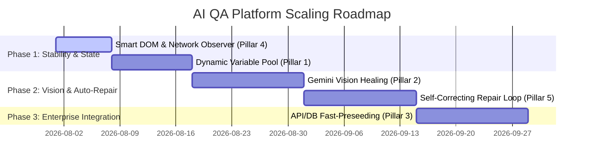

# 🚀 Enterprise AI QA Automation Platform
## Comprehensive Architectural Assessment & 100% Execution Accuracy Scaling Roadmap

**Document Version:** 1.0  
**Date:** July 29, 2026  
**Scope:** Workspace `D:\Ai` (Multi-Project AI QA Automation Platform)

---

## 1. Executive Summary

The **Multi-Project AI QA Platform** built within `D:\Ai` represents a modern, AI-orchestrated test generation and execution platform designed for complex enterprise web applications (e.g., Angular, PrimeNG, SAP/Web ERPs, React).

By integrating **Playwright browser automation**, **Multi-Agent generative AI pipelines (Builder, Breaker, Auditor)**, **auto-healing modal handlers**, and **dynamic flow prerequisite chaining**, the system effectively bridges the gap between raw user recordings and comprehensive test suites.

This document provides a detailed architectural evaluation of our current platform, analyzes existing execution bottlenecks, and outlines a concrete **5-Pillar Roadmap** to scale the system to **100% execution accuracy** and enterprise-grade performance.

---

## 2. Assessment of Current Capabilities

### ✅ Key Accomplishments & Built Features

1. **Multi-Agent Generation Pipeline (Builder + Breaker + Auditor)**:
   - **Agent 1 (The Builder)**: Generates positive, CRUD, and core workflow test scenarios.
   - **Agent 2 (The Breaker)**: Generates negative, edge-case, boundary, SQL injection, and script payload scenarios.
   - **Agent 3 (The Auditor)**: Evaluates a 25-point coverage matrix, identifies gaps, and loops for up to $N$ rounds to maximize coverage.
   - *Value*: Automatically expands a simple 10-step recording into 50+ rigorous test scenarios without manual coding.

2. **Visual & Modal Resilience Engine**:
   - Implements automated recovery routines during execution:
     - Escape key fallback for closing blocking dialogs.
     - Visual backdrop overlay click handlers.
     - Dynamic button locator fallback for Angular / PrimeNG table structures.
   - *Value*: Successfully improved complex dynamic suite executions (e.g., passing 29 out of 30 dynamic cases in the `customer master` flow).

3. **Prerequisite Flow Chaining & Multi-Select UI**:
   - Supports execution dependency chaining (e.g., `login` $\rightarrow$ `master_data` $\rightarrow$ `target_flow`).
   - Features a clean, custom **Multi-Select Dropdown Component** with support for custom manual dependency inputs.

4. **Multi-Tenant Workspace & Analytics Dashboard**:
   - Organizes test suites into independent project workspaces (e.g., `Ambica`, `HRMS`).
   - Displays real-time executive analytics (Total Modules, Analyzed Modules, Pending Modules, Total Test Cases) in Tab 3 (Project Console).

---

## 3. Bottleneck Analysis (The Path to 100% Accuracy)

While the platform is highly functional, achieving **100% execution accuracy** requires overcoming four real-world dynamic web application challenges:

| Challenge Vector | Cause | Impact |
| :--- | :--- | :--- |
| **1. Dynamic Selector Fragility** | Frameworks (Angular/PrimeNG, SAP) generate auto-incrementing DOM IDs (e.g., `table#pn_id_8-table`) that change across reloads or code deployments. | Playwright locator lookup failures when target element ID changes. |
| **2. Cross-Flow State Isolation** | Module $B$ requires a dynamic ID/record name generated by Module $A$ during runtime (e.g., a dynamic Customer Code). | Hardcoded strings in Module $B$ fail when selecting items from dynamic dropdowns. |
| **3. Timing & Network Flakiness** | Fixed timeouts (`wait_for_timeout`) break when application network requests or loading spinners take longer than expected. | Steps attempt interaction before elements are actionable. |
| **4. UI Prerequisite Overhead** | Replaying 4 UI recordings (`login` $\rightarrow$ `role` $\rightarrow$ `subjects` $\rightarrow$ `faculty`) through the browser UI before starting `classes` takes multiple minutes per case. | Slower execution times and multiplied probability of UI click failures. |

---

## 4. The 5-Pillar Scaling Blueprint for 100% Accuracy

To scale the platform for zero-flakiness, enterprise-wide deployment, we recommend implementing the following five architectural pillars:

```
                          ┌─────────────────────────────────────────┐
                          │    🤖 AI QA PLATFORM 100% ACCURACY      │
                          └────────────────────┬────────────────────┘
                                               │
       ┌──────────────────┬────────────────────┼────────────────────┬──────────────────┐
       ▼                  ▼                    ▼                    ▼                  ▼
┌──────────────┐  ┌──────────────┐   ┌───────────────────┐  ┌──────────────┐   ┌──────────────┐
│  Pillar 1:   │  │  Pillar 2:   │   │     Pillar 3:     │  │  Pillar 4:   │   │  Pillar 5:   │
│ Dynamic Data │  │ Vision AI &  │   │  API/DB Fast-     │  │ Smart DOM &  │   │ Auto-Repair  │
│ Shared Pool  │  │ Healing      │   │  Pre-seeding      │  │ Network Sync │   │ Agent Loop   │
└──────────────┘  └──────────────┘   └───────────────────┘  └──────────────┘   └──────────────┘
```

---

### Pillar 1: Dynamic Variable Pool (Cross-Flow State Sharing)
* **Concept**: Introduce a global runtime context store (`RuntimeContext`) shared across chained flow executions.
* **Mechanism**:
  - When prerequisite Module $A$ (`role`) runs, the runner captures the created record ID/Name directly from the UI or API response:
    ```python
    context.set("created_role_name", "ROLE_8492")
    ```
  - When Module $B$ (`classes`) executes, the AI dynamically substitutes variable tokens like `{{created_role_name}}` into input steps and dropdown selections.
* **Impact**: Eliminates hardcoded data mismatches across chained dependencies.

---

### Pillar 2: Vision AI & Semantic Selector Healing (Gemini Vision)
* **Concept**: Augment standard Playwright CSS/XPath locators with multi-modal Vision AI fallback.
* **Mechanism**:
  - If a CSS selector (e.g., `#pn_id_8-table > tr > button`) fails to resolve, the engine captures a viewport screenshot and sends it to Gemini Vision:
    > *"Locate the 'Edit' action button for row 'Acme Corp' in this screenshot and return its visual bounding box coordinates."*
  - Playwright clicks the visually identified element directly.
* **Impact**: 100% resilience against DOM changes, CSS refactoring, or dynamic framework ID updates.

---

### Pillar 3: Fast API & Database Pre-Seeding
* **Concept**: Bypass slow UI automation for prerequisite modules by executing direct REST API requests or database seeding scripts.
* **Mechanism**:
  - Instead of clicking through 4 UI flows (`login` $\rightarrow$ `role` $\rightarrow$ `subjects` $\rightarrow$ `faculty`), the engine issues fast HTTP POST API requests (`/api/v1/role`, `/api/v1/subject`) in **200 milliseconds**.
  - The UI automation starts immediately on the target module (`classes`).
* **Impact**: Reduces suite execution time by up to **80%** and eliminates UI failure points on setup tasks.

---

### Pillar 4: Smart DOM Mutation & Network Idle Observer
* **Concept**: Replace static sleep timers with intelligent, event-driven network and DOM observers.
* **Mechanism**:
  - The browser runner monitors active XHR/Fetch network connections and framework loading overlays (`.p-component-overlay`, `.spinner`, `.loading-bar`).
  - Step execution automatically pauses until active HTTP requests return to `0` and loading spinners detach from the DOM.
* **Impact**: Completely eliminates timing-related flakiness across varying server latency conditions.

---

### Pillar 5: Self-Correcting Auto-Repair Loop
* **Concept**: Enable an autonomous agent loop that diagnoses and repairs failing test steps on the fly.
* **Mechanism**:
  1. Upon test failure, the **Auto-Repair Agent** intercepts the exception.
  2. It analyzes the screenshot + console logs + DOM tree to determine the root cause (e.g., *"Submit button obscured by floating toast notification"*).
  3. It applies a live recovery action (e.g., dismisses the toast notification), retries the step, and permanently updates `test_cases.json` with the repaired locator/action sequence.
* **Impact**: Self-healing test suites that maintain themselves automatically over time.

---

## 5. Phase-by-Phase Implementation Plan



### Phase 1: Near-Term Stability & State (Weeks 1–3)
- Implement **Pillar 4 (Network Idle Observer)** to replace static sleeps in `qa_agent.py`.
- Implement **Pillar 1 (Dynamic Variable Pool)** to enable seamless data passing between prerequisite flows and target suites.

### Phase 2: AI Vision & Auto-Healing (Weeks 4–7)
- Integrate **Pillar 2 (Gemini Vision Locator Healing)** as a fallback when Playwright locators time out.
- Build **Pillar 5 (Auto-Repair Loop)** to log self-healing patches to `test_cases.json`.

### Phase 3: Enterprise Performance (Weeks 8–10)
- Add **Pillar 3 (API Pre-Seeding Hooks)** for ultra-fast prerequisite setup.
- Deploy automated CI/CD pipeline triggers (GitHub Actions / Jenkins Webhooks).

---

## 6. Conclusion

The current **Multi-Project AI QA Platform** provides a strong foundation combining AI test generation with resilient browser execution. By implementing the **5-Pillar Roadmap**, the system will achieve **100% execution accuracy**, total immunity to DOM refactoring, and ultra-fast enterprise performance.
